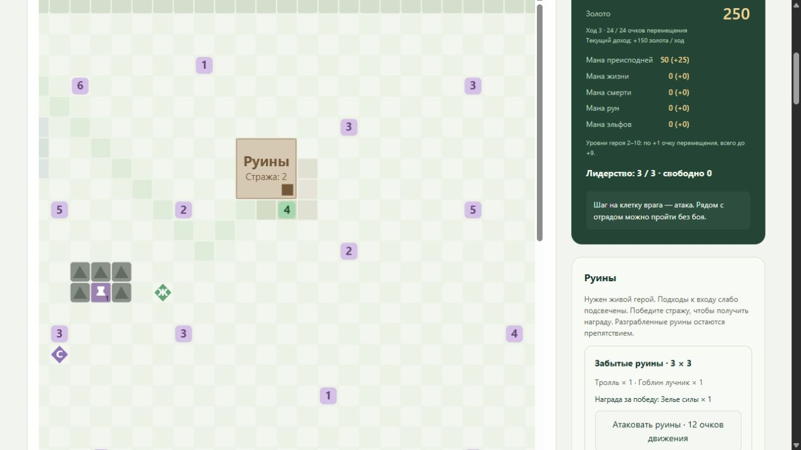

# Строительство, услуги и экономика

[Документация проекта](../README.md#documentation)

- [Строительство столицы](#buildings)
- [Столица, лечение и воскрешение](#recovery)
- [Торговец и тренер](#sites)
- [Лагерь наёмников](#mercenaries)
- [Лидерство, найм и увольнение](#recruitment)
- [Руины](#ruins)

<a id="buildings"></a>
## Строительство столицы

Начальные фракция, золото, постройки и тип правителя задаются выбранным сценарием. Стартовые здания зависят от правителя; см. [стартовые отряды и правители](UNITS.md#parties).

<a id="buildings-действия-и-фракции"></a>
### Действия и фракции

Базовые действия строительства занимают индексы 18–42, отдых — 43,
12 услуг Храма — 44–55 ([лечение и воскрешение](#recovery)),
24 действия зелий — 56–79 ([зелья](ITEMS.md#potions)), превращение в Фенрира — 80.
Полный набор действий зависит от конфигурации среды.
Действие `18 + i` строит здание с индексом `i` в таблице выбранной фракции.
Порядок точно соответствует `Buildings.py` Python-референса. Отдельные диапазоны
действий для каждой расы не создаются.

| Значение `faction` | Фракция | Зданий | Недоступные действия |
| --- | --- | ---: | --- |
| `empire` | Империя | 25 | — |
| `mountain_clans` | Горные Кланы | 24 | 42 |
| `undead_hordes` | Орды Нежити | 25 | — |
| `legions` | Легионы Проклятых | 25 | — |
| `elves` | Альянс Эльфов | 23 | 41, 42 |

Например, действие 18 строит Нечестивый портал у Легионов, Конюшню у Империи,
Пивоварню у Кланов, Проклятую землю у Нежити или Пещеру кентавров у Эльфов.
Все цены, названия, связи и исходные игровые ID находятся в
[`buildings.json`](../stoix/envs/data/buildings.json).

<a id="buildings-правила"></a>
### Правила

- Строить можно с любой клетки карты вне боя, пока эпизод продолжается.
  Столица представлена общим деревом построек; перемещение к отдельной клетке
  столицы не требуется, как и в строительном действии Python-референса.
- Доступность требует достаточного золота, всех зданий-предшественников,
  свободного дневного лимита и отсутствия постоянной блокировки.
- Одно здание строится один раз за эпизод. Цена списывается целиком и точно,
  в целых единицах золота. Например, Нечестивый портал стоит 200,
  Гильдия и Башня магии — по 150, Храм — 300.
- Выбранная ветка навсегда закрывает альтернативные здания из `blocks`.
  Их потомки также показываются заблокированными, поскольку обязательный
  предшественник уже нельзя построить. Боковые ветки не закрываются без
  явного исключения в данных: например, Храм Скорби не блокирует Башню душ.
- **Одно здание за ход карты**. Начальный ход — первый; действие «Отдых»
  начинает следующий, добавляет 100 золота, восстанавливает полный запас очков героя
  и снимает лимит постройки. Один шаг на соседнюю клетку стоит 2 очка.
  Строительство расходует переход среды, но не очки, и доступно даже при нуле
  очков. Исчерпание очков не сбрасывает лимит. Подробности: [WORLD.md](WORLD.md#turns).
- За успешную новую постройку начисляется `building_reward: 0.05`.
  Обычная стоимость перехода `−0.001` сохраняется: чистая награда — `+0.049`.
  Повторные и недопустимые действия ничего не строят, не списывают золото
  и не дают строительной награды. Счётчик построек отдельно логируется в W&B.
- Победа в бою и отступление сохраняют здания, блокировки, золото и лимит
  постройки за ход. Новый эпизод сбрасывает их к настройкам карты. Auto-reset сохраняет
  итоговое наблюдение в `next_obs`, включая постройку на последнем переходе.
- Карта может задать `blocked_buildings` списком ID или названий текущей
  фракции, а также `max_building_level` от 1 до 5 (по умолчанию 5).
  Такие запреты распространяются на потомков. Неизвестные фракции, здания,
  некорректные ограничения и циклы зависимостей отклоняются при загрузке.

Улучшения юнитов после боя требуют нужного здания и опыта; правила — в
[UNITS.md](UNITS.md#progression). Ветки с неподдерживаемыми
способностями явно заблокированы (дополнительно к отсутствующим слотам таблицы
выше). Найм, заклинания и прочие услуги зданий пока не подключены. Выбор
фракции меняет столицу, но не исходный состав отряда.

<a id="buildings-jax-наблюдение-и-интерфейс"></a>
### JAX, наблюдение и интерфейс

Состояние содержит `buildings` и `blocked_buildings` как 25-битные множества,
`built_today` и `last_building`. Зависимости и исключения компилируются в
битовые маски при загрузке. В цикле learner нет обхода Python-графов или
обмена с CPU. `action_mask` и `step` используют один предикат доступности.

Наблюдение v28 содержит **1031 признака**, включая опыт и формы бойцов. Строительство представлено
5 признаками фракции, дневным флагом и 25 статусами: 1 — построено, −1 — постоянно
заблокировано/отсутствует, 0 — ещё не построено. Цены и дерево постоянны для
каждой фракции. Признаки экономики — `gold / 1000` и
`movement_points / 20`; после них идут размеры слотов и признаки боевых эффектов. Маска содержит 87 элементов. Прежние веса с другими
размерами входа/выхода к актуальной карте не подходят.

В разделе «Столица» показаны все здания, цены, требования, взаимные исключения,
состояния и причины недоступности. Фильтр выбирает ветку. Фракция применяется
кнопкой «Новая игра». Браузер передаёт действия и отображает рассчитанные
средой статусы; ручной режим и PPO используют одни правила. Строительство
также отражается в журнале событий и записях агента.

<a id="buildings-источники-и-проверка"></a>
### Источники и проверка

- `C:\Disciples 2 python reference\Big_map\Buildings.py`: все 122 здания,
  русские названия, порядок действий, `requires`, `blocks` и базовые цены.
  SHA-256 файла сохранён в каталоге данных.
- `campaign_env_data.py`: `BUILDING_GOLD_COST_MULTIPLIER = 100.0`.
  `campaign_env_economy.py`: `_building_action_mask_values`, `_step_building`,
  `_get_building_gold_cost`; `campaign_env_territory.py`: снятие `alredybuilt`
  при `_advance_turns`.
- Steam Rise of the Elves: `Globals/Gbuild.DBF` и `Globals/GbuiList.dbf`.
  Для всех 122 записей при переносе проверены цена и `REQUIRED`; исходные ID,
  `LEVEL` и `BRANCH` сохранены. Например, цена Проклятой часовни — именно 620,
  Обители Мортис — 1875, как в этой установленной редакции.
- [D2Ext: модификация зданий столицы](https://d2ext.sklabs.ru/en/articles/modding-buildings-in-the-capital)
  описывает назначение таблиц и полей `COST`, `REQUIRED`, `LEVEL`, `BRANCH`.

GPU-проверки `number_grid_buildings_test.py` охватывают каждое здание пяти
фракций, точный бюджет, все причины отказа, выбор и закрытие веток, границы
дней, сохранение после боя, сброс, маски и терминальное наблюдение обучения.
Сопоставимые замеры скорости — в [TRAINING.md](TRAINING.md#performance).

<a id="recovery"></a>
## Столица, лечение и воскрешение

Столица введена в карте v20 (текущая v78): стартовая клетка `agent_position` (сейчас [2, 2]) — столица без
стража. Только на этой клетке и только вне боя работают платные услуги.
Нужен построенный **Храм**: 300 золота; индекс здания определяется фракцией.
Лечение и воскрешение не расходуют очки перемещения, не завершают ход и не
занимают дневной лимит строительства. Каждая услуга расходует один переход.

<a id="recovery-действия-и-цены"></a>
### Действия и цены

- **44–49**: лечить выбранный слот 0–5. Только живой раненый юнит.
  Восстановить `min(нехватка_HP, gold // цена_за_HP)`, заплатить ровно за
  восстановленные HP. При невозможности купить хотя бы 1 HP действие закрыто.
- **50–55**: воскресить выбранный слот 0–5. Только погибший существующий юнит;
  требуется полная цена, результат — **1 HP**. Уровень и опыт сохраняются.
- Пустой слот и резервная клетка большого юнита не имеют отдельных услуг.
  Расстановка фиксирована, занять резервную клетку другим бойцом нельзя.
- На соседних клетках, без Храма, при нехватке золота, в бою и после завершения
  эпизода услуги недоступны. Маска и step используют один предикат.

| Форма | Золото / HP | Воскрешение |
|---|---:|---:|
| Одержимый, сектант | 1 | 50 |
| Герцог | 1 | 200 |
| Берсерк, колдун | 2 | 200 |
| Тёмный паладин, демонолог | 2 | 400 |
| Адский рыцарь | 3 | 600 |

Полные цены профилей — `stoix/envs/data/units.json`, поля
`heal_gold_per_hp` и `revive_gold`. При смене формы меняется цена. Числовые
уровни, включая постоянные бонусы Герцога, не меняют цены этих профилей:
прирост HEAL_C у всех них нулевой, REVIVE_C привязан к ID формы.

**Отклонение от референса, согласованное пользователем:** HP остаются целыми.
5 золота при цене 2/HP дают 2 HP за 4 золота; 1 золото остаётся.

<a id="recovery-потери-и-награда"></a>
### Потери и награда

Автоматическое воскрешение после победы и отступления удалено. Погибшие
остаются с 0 HP на карте, при отдыхе и в следующем бою до явного
воскрешения Патриархом, услугой Храма или зельем. Живые сохраняют ранения.
Полная гибель отряда завершает эпизод. Прежняя регенерация живых при отдыхе
и полное лечение при повышении сохраняются.

Бонусы RL: **0,0001 за оплаченный восстановленный HP**
и **0,5 за воскрешение**, с раздельным запасом награды против повторного фарма.
Обычная стоимость перехода −0,001 по-прежнему вычитается.

По запросу пользователя от 13 октября 2026 награда за лечение уменьшена
в 100 раз относительно Python-референса (0,01/HP), чтобы восстановление
не доминировало над боевыми целями: 100 HP дают +0,01, а 8000 HP — +0,8
до пошаговых штрафов и при достаточном запасе награды. Это настройка RL,
а не изменение игровых правил лечения. Новый коэффициент применяется
при запуске нового процесса обучения или ручной игры; уже работающий
процесс и история наград прежних запусков не меняются.

Начальные запасы HP и воскрешений равны 0. Только победа добавляет сумму
исходного HP побеждённых и число убитых бойцов. Титан считается одним бойцом;
лечение врагов не увеличивает запас. Отступление, поражение и лимит ничего
не добавляют. Оплаченная услуга разрешена и без запаса, но бонуса не даёт.
За лечение вознаграждается минимум восстановленного HP и положительного
запаса, затем из запаса вычитается **весь** восстановленный HP. Воскрешение
вознаграждается только при запасе ≥1, затем вычитается 1. Отрицательный баланс
сохраняется: будущие победы сначала покрывают долг. Отдых и повышение не
списывают эти запасы — так же, как в референсе.

Исходный HP, нанесённый урон и факт гибели учитываются отдельно для каждого
врага. Зачёт урона ограничен его исходным HP, а гибель учитывается только
один раз: лечение, воскрешение и временные формы не увеличивают бюджет.
Урон периодических эффектов включён; побег от страха сам по себе не даёт
зачёта убийства. Баланс пополняется только после победы.

<a id="recovery-состояние-и-интерфейс"></a>
### Состояние и интерфейс

Текущее наблюдение v28 содержит 1031 признака, пространство действий — 87.
Столица представлена 17 признаками: координаты / (size−1), признак нахождения
в ней, два баланса / [1000,10], шесть пар цен / [3,1000]. Полный состав
наблюдения — в [COMBAT.md](COMBAT.md#battle).

На карте столица выделена золотым. В разделе «Столица» показаны местоположение,
доступность Храма, HP, цены и кнопки услуг. Все суммы и доступность рассчитывает
JAX; браузер отображает готовые `capital_quotes`. Новые события журнала — 17
(лечение) и 18 (воскрешение), оплаченная сумма — `last_service_cost`.

<a id="recovery-источники-и-проверки"></a>
### Источники и проверки

Основа: `C:\Disciples 2 python reference\Big_map`:

- `campaign_env_economy.py`: `_heal_unit_to_full_at_position`,
  `_revive_unit_with_gold_at_position`, `_step_heal_in_castle`,
  `_step_revive_in_castle`, функции бюджета восстановления (строки 2494–2535).
- `campaign_env.py`: исходные `reward_castle_heal_per_hp=.01`, `reward_castle_revive=.5`;
  коэффициент лечения в JAX снижен до `.0001` по запросу пользователя выше.
- `campaign_env_magic.py`: `_has_temple_built`; `campaign_env_masks.py`:
  ограничения клетки, храма и оплаты.
- `unit_service_cost_data.py` и `unit_service_costs.py`: HEAL_C и его
  динамические приросты; `unit_revive_costs.py`: REVIVE_C по исходному ID.
- `battle_env.py`, строки 4061–4085: лимит восстановительного бюджета
  исходным HP каждой жертвы и однократный учёт смерти.
- `test_recovery_budget_and_siege.py`: отдельные запасы, отрицательный
  баланс, начисление только за победу и защита от повторного лечения врага.

GPU-проверки: `stoix/tests/number_grid_capital_test.py`, обновлённые проверки
регенерации, XP, масок, построек и трансформаций JAX. Уровни и цены, точная
стартовая клетка, требования Храма, целое частичное лечение, сдача, 1 HP при
воскрешении, недопустимые действия, сохранение погибших и бюджет награды.

Ожидания награды обновлены в `test_integer_partial_healing_change_cap_and_no_turn_cost`
(2 оплаченных HP дают +0,0002 до стоимости решения) и
`test_reward_allowances_are_separate_and_keep_reference_debt`
(из 10 восстановленных HP награждаются только 3: +0,0003).
После изменения коэффициента тесты и замеры не запускались.

В v78 услуги доступны также на клетках своих захваченных городов. Цены, требования столичного Храма, бюджет наград и эффекты сохраняются. Нейтральный город не открывает услуги, даже если защитники уже побеждены: сначала требуется захват живым героем. [Правила городов](WORLD.md#territory).

<a id="sites"></a>
## Торговец и тренер

В `number_grid_map.json` размещены торговец с верхней левой клеткой [8, 3] и тренер
с верхней левой клеткой [5, 10]. Координаты NumberGrid: [строка, столбец].
Оба объекта занимают непроходимый квадрат 3×3. Пять клеток взаимодействия
относительно верхней левой клетки: [1,3], [2,3], [3,1], [3,2], [3,3].
Вход находится у нижнего правого угла. Северная и западная стороны доступа
не дают. Эти пять клеток слабо подсвечены цветом соответствующего объекта.

<a id="sites-покупки-и-автопродажа-драгоценностей"></a>
### Покупки и автопродажа драгоценностей

| Действие | Товар | Начальный запас | Цена, золото |
| --- | --- | ---: | ---: |
| 171 | Эликсир неуязвимости, +50 брони до отдыха | 1 | 700 |
| 172 | Банка исцеления, до 50 HP | 10 | 150 |
| 173 | Зелье воскрешения, возвращает 1 HP | 10 | 400 |

Покупка выдаёт одну бутылку и уменьшает запас торговца на один. Отдых запас
не восстанавливает, новый эпизод восстанавливает. Состав и количество товаров
заданы сценарием по запросу пользователя. Под «зельем лечения» выбрана базовая
банка на 50 HP. Все цены подтверждены GItem.VALUE установленной редакции.

Ручная продажа зелий и снаряжения удалена по запросу пользователя.
Для неё нет действий в пространстве агента, обработчиков в JAX и кнопок
в визуализации. Заменённые и дублирующиеся вещи остаются в инвентаре.

Все драгоценности автоматически продаются, когда отряд находится на клетке
взаимодействия с торговцем. Продажа выполняется после сбора сундуков на
допустимом шаге карты, поэтому только что найденные драгоценности также могут
быть проданы. Зелья и снаряжение автоматически не продаются. Дубликаты продаются
все по 20% базовой цены (GVars.SELL_RATIO), повторный заход не даёт повторной выручки. Это автоматизация
Python-референса и явное требование пользователя, а не утверждение об
автоматической продаже в оригинальном интерфейсе.

Lute of Charming снижает цену покупки на 10% с целочисленным округлением вниз.
Две копии скидку не удваивают, продажу и обучение скидка не меняет; используется
правило _shop_buy_price из референса. Остальные способности торговли героя
в рамках этой задачи не добавлялись.

<a id="sites-обучение"></a>
### Обучение

Действия 174–179 соответствуют шести слотам отряда; герой обучается на общих
основаниях. Только живой непустой слот с недостающим опытом может обучаться;
для покупок и обучения нужен живой герой. Во время боя и после конца
эпизода услуги недоступны. Очки движения и день не расходуются, можно
взаимодействовать при нуле очков. Браузер получает цены и маску из JAX.

Цена одного XP берётся из Gunits.TRAINING_C для постоянной формы юнита:
базовая цена + ранние уровни × GDynUpgr.TRAINING_C(DYN_UPG1) + поздние уровни ×
GDynUpgr.TRAINING_C(DYN_UPG2). Граница ранних уровней — DYN_UPG_LV.
В установленной редакции для всех 356 импортированных профилей обе прибавки
равны нулю, но базовые цены различаются. Стартовые Одержимые, Сектанты и Герцог:
4 золота за XP. Таблица: stoix/envs/data/training_prices.json.

Покупается min(порог − 1 − текущий XP, floor(золото / цена XP)).
Оставшееся золото сохраняется. Тренировка не повышает уровень, не меняет форму,
не лечит, не расходует бонусы и не получает множитель боевого опыта от книги.
Последний XP необходимо заработать в бою. У героя используется актуальный
порог его уровня: например, Герцог уровня 2 может обучиться до 649/650 XP.

<a id="sites-источники"></a>
### Источники

- Установленная Steam Rise of the Elves: Globals/GItem.DBF (три товара),
  GVars.DBF (SELL_RATIO=20), Gunits.dbf и GDynUpgr.DBF (TRAINING_C).
  SHA-256 и выбранные записи сохранены в [site-sources.json](validation/site-sources.json).
- DII Manual.pdf, страницы PDF 13 и 15: обучение отряда и лидера;
  последний опыт перед повышением приходит из боя.
- Python-референс: Big_map/maps/default.py:463–558 (входы),
  maps/wotans_retribution.py:_object_footprint_blocks (непроходимые объекты),
  campaign_env_inventory.py:_sell_sell_only_heroitems_at_merchant и
  _shop_buy_price; campaign_env_map.py:_trainer_preview_for_position,
  _step_train_unit_at_trainer; unit_service_costs.py.
- [D2RSG site.h](https://github.com/VladimirMakeev/D2RSG/blob/master/ScenarioGenerator/src/scenario/site.h)
  задаёт размер 3×3, [mapelement.h](https://github.com/VladimirMakeev/D2RSG/blob/master/ScenarioGenerator/src/scenario/mapelement.h)
  описывает вход в нижнем правом углу и ровно пять смещений подхода. Это
  генератор совместимых сценариев, используемый как независимое подтверждение
  геометрии референса, а не изменение правил модом.

<a id="sites-несколько-объектов-одного-вида"></a>
### Несколько объектов одного вида

Карта может задать один объект ключом `merchant`, `trainer`, `mercenary`, `spell_shop` или список ключом `merchants`, `trainers`, `mercenaries`, `spell_shops`. Оба ключа одного вида сразу запрещены. Геометрия, проверки и подходы у всех объектов одинаковые. Порядок объектов: торговцы, тренеры, лагеря, лавки заклинаний.

- Товар торговца продаётся только у его входа. Если продаёт один торговец, действия называются `buy_<товар>`, иначе `buy_<номер>_<товар>`. Торговец без товаров только скупает драгоценности.
- Наёмник нанимается только у своего лагеря. Если один юнит есть в двух лагерях, в имени действия появляется номер лагеря.
- Обучение доступно у любого тренера.

Наблюдение получает по признаку «у входа» на каждый лагерь. Для карт с одним объектом каждого вида действия, признаки и переходы не изменились: случайные прогоны текущей карты совпадают побитно.

<a id="sites-предметы-у-торговца"></a>
### Предметы у торговца

Кроме зелий торговец может продавать любой предмет [каталога](ITEMS.md#equipment) с ценой: артефакты, знамёна, книги, сапоги, сферы, талисманы, свитки и посохи. Запас задаётся ключом `items` рядом с `potions`:

```json
"merchants": [{"name": "Лавка Алара", "position": [35, 22],
               "potions": {"life": 10},
               "items": {"runestone": 1, "orb_of_fire": 1, "lightning_scroll": 2}}]
```

- Драгоценности торговец не продаёт, он их только скупает. Сферу ликантропии продать нельзя: в установленной игре её нет и цены у неё нет.
- Каждое предложение — отдельное действие `buy_<ключ>` после зелий своего торговца. Условия те же, что у зелий: вход торговца, живой герой, вне боя, запас не исчерпан, хватает золота. Очки движения и день не расходуются. Отдых запас не восстанавливает, новый эпизод восстанавливает.
- Цена — каталожная `price` (`GItem.VALUE`); Lute of Charming снижает её на 10%, как у зелий.
- Купленная вещь сразу попадает в инвентарь, и в том же шаге проходит обычный автовыбор экипировки: более дорогая вещь заменяет надетую, требования навыков героя действуют. Сферы и талисманы герой затем кладёт в [боевые слоты](ITEMS.md#battle-items), свитки и посохи применяются на карте ([правила](MAGIC.md#spell-items)). Так референс выдаёт товары с `grant: "inventory"` (`campaign_env_map.py:_grant_merchant_item`, `_step_buy_merchant_item`).
- Вместимость инвентаря включает весь запас торговцев, поэтому покупке всегда хватает места.
- Наблюдение: для каждого предложения остаток (доля начального запаса) и текущая цена / 1000, как у зелий. Вид, который есть только у торговца, добавляет слот инвентаря, а сфера, талисман, свиток или посох — ещё и своё действие (`equip_<ключ>` или `cast_<ключ>`). Признаки содержимого сундуков и руин по таким видам не добавляются: в сундуках их нет.

На [карте Default](DEFAULT_MAP.md#лавки-и-действия) по запросу пользователя Лавка Алара, кроме десяти зелий, продаёт один артефакт: Runestone (+10 брони герою, 500 золота), действие 157. В референсе и в самом сценарии Алар продаёт только зелья (`MERCHANT_BUY_ITEMS`, `A Return To Simpler Times.sg`, `S001SI0001`); артефакты, знамёна, сапоги, сферы и талисманы торговец референса продаёт на карте `trade_train`. Шлемов отдельной категорией в данных игры нет: обруч и корона (Etched Circlet, Mjolnir's Crown) входят в артефакты, а Tiara of Purity защищает от воров, которых в среде нет, и в каталог не входит.

<a id="sites-лавка-заклинаний"></a>
### Лавка заклинаний

Объект 3×3 с теми же пятью клетками входа. Каждое предложение — заклинание, цена и запас:

```json
"spell_shop": {"name": "…", "position": [3, 43],
               "spells": [{"spell": "g000ss0019", "price": 1000, "stock": 1}]}
```

Действие `buy_spell_<id>` доступно у входа с живым героем вне боя, если запас не исчерпан, хватает золота и заклинание ещё не изучено (`_step_buy_spell_shop_spell` референса). Покупка списывает золото, уменьшает запас, ставит бит знания и даёт событие 51; награды нет, очки движения не тратятся. Заклинание другой фракции добавляется к книге для [применения](MAGIC.md#casting-заклинания-из-лавки). В наблюдении для каждого предложения есть остаток и цена.

Используется на [карте Default](DEFAULT_MAP.md): Ледяной столб, Чума, Каменный дождь и Исцеление по 400 золота, как в оригинале; на Small — Армагеддон и Вердант по 1000 золота.

<a id="mercenaries"></a>
## Лагерь наёмников

Лагерь расположен в [6,6] (строка, столбец верхнего левого угла) и занимает
непроходимый квадрат 3×3. Взаимодействие возможно только с клеток
[7,9], [8,9], [9,7], [9,8], [9,9], слабо подсвеченных на карте.
Все пять подходов достижимы от столицы без боя. Эти клетки не дают услуг
столицы, торговца или тренера.

| Действие | Наёмник | Цена, золото | Запас | Лидерство | Размещение |
|---|---|---:|---:|---:|---|
| 185 | Варвар, g000uu5040 | 850 | 1 | 1 | Первый свободный передний слот 0, 1 или 2 |
| 186 | Гоблин лучник, g000uu5018 | 50 | 1 | 1 | Первый свободный задний слот 3, 4 или 5 |

Оба предложения доступны всем пяти фракциям. Нужны живой герой, свободное
лидерство, незанятый слот соответствующего ряда и достаточно золота.
Погибшие бойцы продолжают занимать место и лидерство; задняя клетка большого
союзника также занята. Постройки столицы не требуются. Во время боя и после
завершения эпизода найм недоступен. Можно нанимать при нуле очков движения;
день и очки не меняются.

Новый боец имеет первый уровень, полный запас здоровья (варвар 250 HP,
гоблин-лучник 40 HP) и нулевой опыт. Старые эффекты освобождённого слота
очищаются общей механикой найма. Опыт, бой, лечение, воскрешение и увольнение
далее работают как для остальных постоянных бойцов.

Запас уменьшается при успешном найме. Отдых, увольнение или гибель бойца
его не возвращают. Новый эпизод восстанавливает по одному наёмнику.
Lute of Charming снижает цену на 10% с округлением вниз: 765 и 45 золота;
две лютни не складывают скидку. Это правило распространяется на наёмников,
но не на найм своей фракции в поселениях.

Сценарий может задавать `price` в каждой записи `mercenaries[].roster`:
положительное целое количество золота. Если поля нет, используется `ENROLL_C`
из установленного каталога, как у двух предложений выше. Скидка применяется
к выбранной базовой цене; наблюдение, интерфейс, маска и `step` используют
одну таблицу цен. Это необходимо для восьми элитных предложений
[Trade Train](TRADE_TRAIN.md), чьи цены отличаются от обычного найма.
Такие бойцы приходят на базовом уровне своего профиля, а не обязательно на первом.
Источник: `Big_map/maps/trade_train.py:ELITE_MERCENARIES`,
`campaign_env_map.py:_create_initial_mercenary_site_rosters` и
`campaign_env_economy.py:_step_hire_mercenary_unit` Python-референса.
Проверки: `stoix/tests/number_grid_trade_train_test.py`.

Награды общие с [наймом своей фракции](#recruitment): +3 только за новый
рекорд занятого лидерства за эпизод, штраф −0,05 за каждое свободное очко
на каждом шаге. Обычная стоимость шага −0,001 сохраняется. Стартовый отряд
уже занимает 3/3: для найма нужно освободить место или повысить лидерство героя.

Увольнение теперь занимает действия 187–192, улучшения городов — 193–194.
Пять предложений своей фракции остаются на 180–184. Блок найма в наблюдении
расширен до семи ID, цен с учётом скидки и целевых слотов; добавлены два
остатка запаса, признак нахождения у лагеря и его координаты. Маска и step
используют одни JAX-правила, браузер только показывает цены и отправляет
действия. Веса v35 несовместимы с новым форматом.

<a id="mercenaries-источники"></a>
### Источники

- Python-референс: Big_map/maps/default.py:498–545 — варвар 850, гоблин-лучник
  50, по одному, геометрия лагерей. В текущем сценарии два предложения объединены
  в один лагерь по запросу пользователя; координаты выбраны для карты NumberGrid.
- Big_map/campaign_env_economy.py:2233–2421 — проверки живого героя, места,
  лидерства, запаса, цены; создание бойца, уменьшение запаса, отсутствие требований зданий.
- Big_map/campaign_env_map.py:33–49, 574–660, 937–970 — передний/задний ряд,
  награда за найм, исходный запас. Больших наёмников референс не разрешает.
- Big_map/campaign_env_inventory.py:1962–1968 — скидка от лютни.
- Установленные Globals/Gunits.dbf и импортированный каталог
  stoix/envs/data/units.json: ENROLL_C = g0850 и g0050, размер 1, базовые HP.
  Хеши и записи: [mercenary-sources.json](validation/mercenary-sources.json).

Подтверждающие CUDA-тесты: stoix/tests/number_grid_mercenary_test.py и
расширенные number_grid_recruitment_test.py / number_grid_sites_test.py:
все фракции, цены и скидка, требования и запреты, строки размещения,
ограниченный запас, reset, награды, геометрия, проходимость, маска/step,
наблюдение и данные ручного интерфейса.

Ручная игра проверена через штатный CUDA-сервер: герой дошёл до [7,9],
освободил переднее и заднее место, нанял обоих бойцов (золото 1000 → 150 → 100,
запас 1/1 → 0/0), день и движение сохранились. Новый эпизод восстановил
по одному наёмнику; ошибок JavaScript нет, GET страницы — 200.
[Протокол интерфейса](validation/mercenary-ui.json).

<a id="recruitment"></a>
## Лидерство, найм и увольнение

В [Default Capital](DEFAULT_MAP.md#capital) по запросу 16.10.2026 действует
`recruitment_reward_faction_only: true`: лагерный наёмник даёт **0** за найм
и не уменьшает штраф −0,05 за незаполненное место на решение агента.
Для наград занятыми считаются только места обычных бойцов; для допустимости
найма учитываются все бойцы. Наёмник не повышает рекорд оплаченного заполнения.
После его увольнения обычный найм может получить +3 за новое рекордное место.
Происхождение хранится у бойца, переносится при перестановках и не меняется
после повышения, гибели или превращения. Шесть флагов наблюдения Capital
показывают его агенту. Начальные бойцы считаются обычными. Это настройка RL из
запроса пользователя; проверки добавлены в `number_grid_capital_training_test.py`
и не запускались. Далее описана общая схема для остальных карт.

Правила перенесены из Python-референса. Начальный отряд зависит от фракции и правителя ([стартовые отряды](UNITS.md#parties)).

<a id="recruitment-лидерство-и-размещение"></a>
### Лидерство и размещение

Герой не расходует лидерство. Вместимость спутников: 3 на уровнях 1–2,
4 на уровнях 3–5 и 5 с уровня 6. Обычный боец расходует 1, большой — 2.
Погибшие занимают клетки и лидерство до увольнения. Погибший герой сохраняет
вместимость. Без героя вместимость и свободное лидерство равны нулю.
Копии, временные превращения и боевые призывы не меняют состав для этого расчёта.

Найм размещает малого воина в первое свободное место 0, 1 или 2. Центральная
клетка не резервируется под героя: если герой стоит сзади, её можно занять
новым бойцом. Это относится и к найму своей фракции, и к наёмникам.
Остальные малые бойцы занимают первое место
3, 4 или 5. Большой занимает полностью свободную линию 0+3, 1+4 или 2+5:
его состояние хранится в передней клетке, задняя резервируется. Погибший в
любой клетке блокирует линию. Дополнительного ограничения уровня для больших нет.

<a id="recruitment-найм"></a>
### Найм

Действия 180–184 — пять предложений выбранной фракции, без ограничения запаса.
Найм доступен на клетке столицы [2, 2], совпадающей со стартом и лечением,
и на клетках захваченных [городов](WORLD.md#territory). На картах без земли
список клеток задаётся recruitment_positions. Нужны герой
(в том числе погибший), золото, свободное лидерство, место нужного типа и,
для специальных юнитов, построенное здание. Скидки торговца не действуют.
Новый боец получает исходный уровень, полное HP и нулевой опыт; эффекты
уволенного ему не передаются. Найм не расходует движение и не завершает ход.

| Фракция | Предложения, цена в золоте | Требование специального юнита |
|---|---|---|
| Империя | Скваер 50; Ученик 60; Лучник 40; Служка 50; Титан 300 | Титан — Разрушенный храм |
| Горные кланы | Гном 50; Травница 60; Метатель топоров 40; Йети 400; Холмовой гигант 100 | Йети — Горное логово |
| Орды нежити | Воин 50; Адепт 60; Привидение 50; Оборотень 1000; Виверна 100 | Оборотень — Логово оборотней |
| Легионы Проклятых | Одержимый 50; Сектант 60; Гаргулья 80; Сатир 300; Чёрт 100 | Сатир — Храм Скорби |
| Эльфы | Кентавр копейщик 50; Адепт эльфов 60; Рейнджер 40; Медиум 50; Грифон 300 | Грифон — Птичник |

Нужные здания используют существующее дерево строительства со всеми его
предпосылками. Выбор фракции в ручной игре определяет и дерево, и пять
предложений. Стартовый отряд берётся по фракции и правителю из таблицы референса, если карта не задаёт `hero_roster`.

<a id="recruitment-увольнение-и-награды"></a>
### Увольнение и награды

Действия 187–192 соответствуют шести клеткам своего отряда. Увольнение доступно
на любой клетке карты при живом герое, вне боя и до завершения эпизода.
Героя увольнять нельзя. Можно уволить живого или погибшего спутника; нажатие
на любую из двух клеток большого освобождает обе. Возврата золота нет.
Движение и день не меняются, собственная награда увольнения равна нулю.

После каждого шага среды штраф равен 0,05 × свободное лидерство в полученном
состоянии. Он применяется и в бою, и при отдыхе, и при недопустимой команде.
Внутренние автоматические активации противника не получают отдельный штраф;
он начисляется один раз за решение агента. После уже завершённого эпизода
дополнительного штрафа нет.

Успешный найм даёт +3, только если занятое лидерство превысило прежний максимум
за эпизод. Большой даёт одну такую награду, а не две. Рекорд начинается с
начального заполнения (3), не уменьшается после увольнения или гибели и
обнуляется до стартового значения при reset. Цикл увольнение–повторный найм
награду не приносит. Награда складывается с прежней ценой шага −0,001 и
штрафом свободного лидерства; например найм четвёртого спутника при лидерстве
4 даёт 2,999. Дополнительная цель full_party из референса не включена:
цель текущей карты — победить все вражеские отряды и захватить оба города.

<a id="recruitment-наблюдение-и-интерфейс"></a>
### Наблюдение и интерфейс

Расширение v33 добавило 21 признак. В v35 блок найма включает: вместимость, занятое, свободное и рекорд
найма (делитель 5); семь ID предложений (делитель размер каталога), семь цен
(/1000), семь целевых клеток ((slot+1)/6; 0 при отсутствии), координаты столицы
(/47), два остатка запаса лагеря и признак взаимодействия с ним. Маска и step используют одинаковые ограничения. Старые веса несовместимы.
В столице показаны предложения и требуемые здания; у бойцов — кнопки увольнения,
рядом с составом — занятое и доступное лидерство. Решения принимает JAX.

<a id="recruitment-источники-и-проверки"></a>
### Источники и проверки

Размещение в свободном центре переднего ряда исправлено 20 октября 2026.
Источник: установленное `DII Manual.pdf`, стр. 10 PDF, разделы `Hire a Unit`
и перестановки бойцов — найм в незанятые позиции и свободное размещение отряда.
Резервирование центра под героя было ограничением Python-прототипа.
Регрессии `test_faction_and_mercenary_hire_into_free_front_center` и
`test_occupied_front_center_blocks_faction_and_mercenary_hire` в
`stoix/tests/number_grid_recruitment_test.py` проверяют маску и `step` для
воина в тылу, мага и разведчика, заполненного заднего ряда, живого и погибшего
бойца в центре, включая большого. Проверка больших юнитов дополнена наймом
в центральную линию и запретом занять её заднюю клетку.
Используются общие среда и JIT-функции набора; новые регрессии не запускались.

Python-референс: C:/Disciples 2 python reference/Big_map/campaign_env_data.py
(константы лидерства, размещения и предложений), hire.py (базовые предложения),
campaign_env_economy.py (_party_hire_composition, _can_hire_faction_unit_option,
_step_dismiss_blue_unit, _apply_leadership_step_penalty), campaign_env_inventory.py
(_hire_reward_value), campaign_env.py (значения наград по умолчанию и reset),
tests/test_unit_dismissal.py (увольнение и защита от повторной награды).
Цены и здания подтверждены полями ENROLL_C/ENROLL_B установленной редакции,
сохранёнными в stoix/envs/data/units.json и buildings.json.
Это конкретная схема лидерства Python-референса, а не вывод из поля LEADERSHIP
герцога в оригинальном Gunits.DBF. Приоритет здесь — явно запрошенный перенос.
Хеши источников: validation/recruitment-sources.json.

CUDA-регрессии: stoix/tests/number_grid_recruitment_test.py — все 25 предложений,
пороги лидерства, размещение, специальные здания, погибший герой, погибшие
большие юниты, запрет найма вне разрешённых поселений, маска/step, очистка эффектов, награды,
reset и сохранение нанятых в первоначально пустые клетки после победы.

Действия 185–186 — [найм варвара и гоблина-лучника в лагере](#mercenaries).

<a id="ruins"></a>
## Руины

Руины «Забытые руины» расположены в [7,23] (строка, столбец верхнего левого угла).
Они занимают квадрат 3×3: строки 7–9, столбцы 23–25. Нижняя правая клетка
[9,25] — цель команды нападения. Допустимые внешние подходы:
[8,26], [9,26], [10,24], [10,25], [10,26]. В визуализации они слабо выделены.

Защитники — тролль g000uu5016 (350 HP, 120 урона, инициатива 40),
занимающий переднюю и заднюю клетки центральной линии, и гоблин-лучник
G000UU5018 (40 HP, 15 урона, инициатива 50) в верхнем заднем слоте.
Это обычный тролль, не вариант предводителя g000uu5116. Они используют
общие характеристики, опыт, размер, досягаемость и боевые правила.

Для нападения нужен живой настоящий герой и хотя бы одно очко движения.
Команда 0–7 в сторону входа начинает обычный бой. Стоимость — половина
максимального запаса движения с округлением вверх, ограниченная остатком.
Отряд остаётся на своей клетке. Подойти с обратной стороны постройки нельзя.
Маска и принудительный step одинаково проверяют эти условия.
Защитники руин от страха парализуются, как в Python-референсе; атакующий
отряд может отступить от страха. Городскую броню руины не дают.

После полной победы отряд один раз получает **Зелье силы** G000IG0015:
+30% урона выбранному живому бойцу до следующего отдыха. Это временное зелье,
а не постоянный эликсир титана. Награда текущих руин не содержит золота.
Победа без живого героя в конце боя всё равно выдаёт добычу оставшимся
бойцам; живой герой требуется при входе. Отступление, поражение и прекращение
боя без победы добычу не выдают. Раненая стража при отдыхе восстанавливает
ровно 20% максимума (GVars REGEN_RUIN, [правило](MAGIC.md#casting-раны-и-восстановление-врагов)).
Очистка учитывает заключительные ходы целителей.

Руины получают признак «разграблены», их стража удаляется с карты, повторный
бой и повторная награда недоступны. Все девять клеток остаются препятствием
и не входят в распространение земли. В новом эпизоде стража и награда
восстанавливаются. Обычные полевые отряды сохраняют прежнее поведение.

Конфигурация поддерживает список ruins с position, name, potions, items и
необязательным gold. Снаряжение проходит через общий инвентарь и автовыбор:
артефакты и сапоги сразу учитываются в характеристиках по действующим правилам.
Ёмкость инвентаря включает все сундуки и руины. Запас зелий и набор действий
учитывают добычу руин даже до её получения.

Дополнительная награда RL за очистку — +0,25 поверх обычной +1 за бой,
как стандартный reward_ruin_clear_bonus Python-референса. Обычная цена шага,
штраф свободного лидерства и +3 за полную победу на карте сохраняются.
Отдельное действие входа не добавляется. Зелье силы добавило 6 действий
применения: теперь 18 доступных видов × 6 целей. Покупки — 171–173,
тренер — 174–179, найм своей фракции — 180–184, наёмники — 185–186,
увольнение — 187–192, улучшения городов — 193–194.

В наблюдение добавлены пять признаков нового отряда, шесть признаков нового
вида зелья (инвентарь и пять сундуков) и 37 признаков руин: координаты,
18 количеств зелий, 15 количеств предметов, золото и флаг разграбления.
Старые веса v35 не подходят новому размеру наблюдения и действий.

<a id="ruins-источники-и-границы-переноса"></a>
### Источники и границы переноса

- Python-референс Big_map/maps/default.py:381–410,568–603 и
  maps/wotans_retribution.py:65–88,268+: размер 3×3, маркер в нижнем правом
  углу, один отряд защитников, предметы и золото. Пять внешних подходов
  следуют из восьми направлений движения и восьми блокированных клеток.
- campaign_env_map.py:10–30 и campaign_env.py:1484: руины требуют живого героя.
- campaign_env_territory.py:724–803: однократная награда, инвентарь, золото,
  множество очищенных руин. campaign_env_battle.py:250–320: награда после
  победы, возвращение на исходную клетку; :807–839 — страх защитников.
- campaign_env.py:315–317 и campaign_env_inventory.py:3408+: бонус RL.
- Установленное DII Manual.pdf, разделы The Game Landscape и Combat:
  стража, ценности, отсутствие повторной добычи, запрет посещения с мёртвым
  лидером. Использована сохранённая текстовая выдержка Big_map/tmp/manual.txt.
- Установленное Scenedit manual/Disciples 2 Scenario Editor Manual.htm,
  раздел Ruins: состав стражи, Bonus Gold, Reward Selection, Looted Button.
  Разграбленные руины не допускают действий.
- Globals/Gunits.dbf, GAttacks.dbf, GItem.dbf, GmodifL.dbf установленной
  Rise of the Elves и импортированные каталоги: тролль, гоблин-лучник,
  G000IG0015 и модификатор +30% damage. Хеши и значения сохранены в
  [ruin-sources.json](validation/ruin-sources.json).

Координаты, состав и награда — настройки текущего сценария по запросу
пользователя. Референс оставляет клетку маркера отдельно от восьми статических
препятствий и не блокирует её дополнительно после очистки. Здесь по прямому
запросу пользователя весь квадрат остаётся препятствием: вход разрешён
только как нападение, без физического перехода внутрь. Это отличие явно
зафиксировано; оригинальная игра и IDA автоматически не запускались.

Проверки: number_grid_ruins_test.py (геометрия, живой герой, JIT/vmap,
стоимость входа, однократная добыча, эффект зелья, экипировка, reset,
страх, отсутствие брони и данные интерфейса); общий маршрут через все
46 отрядов и оба города в number_grid_combat_stats_test.py.

Ручная проверка интерфейса: отряд дошёл до [10,25] обычными командами,
атаковал за 12/24 очков, победил тролля и гоблина-лучника и получил ровно
одно зелье силы. Серые разграбленные руины остались непроходимыми; повторная
атака исчезла. Новый эпизод восстановил стражу. Ошибок JavaScript нет,
GET /viewer.html — 200. [Протокол UI](validation/ruin-ui.json).


