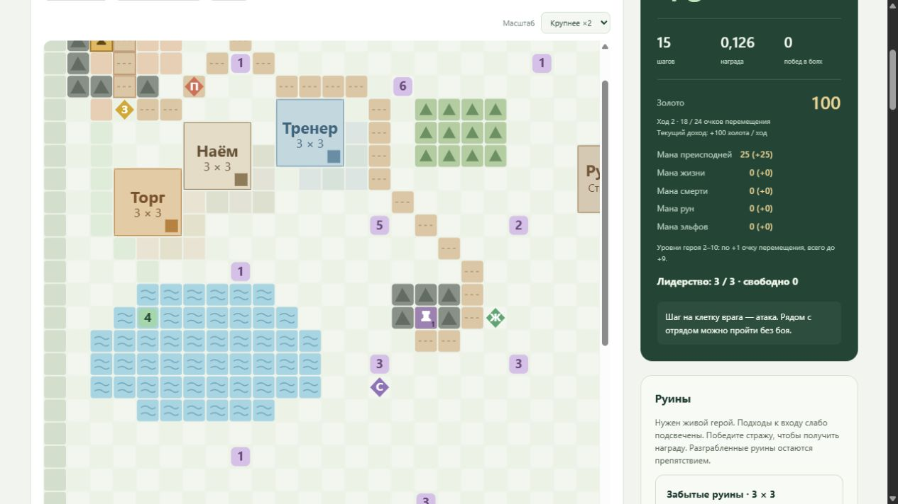

# Ходы, передвижение и территория

[Документация проекта](../README.md#documentation)

- [Ход карты и отдых](#turns)
- [Рельеф и передвижение](#terrain)
- [Земля, источники и города](#territory)

## Ход карты и отдых

Передвижение использует согласованные правила RL-прототипа; они не означают полного соответствия Disciples II.

- Начало эпизода: ход 1, полный запас героя (20 у Герцога; у других героев 20–35, без живого героя 20, [стартовые герои](UNITS.md#parties)), золото и мана из карты (`starting_gold`, `starting_mana`; без них 0; на Default 400 золота и 200 маны преисподней). Маг начинает с Башней магии, владелец гильдии — с Гильдией; у воина готовых зданий нет.
- Цена входа в клетку: дорога 1, равнина 2, лес 4, вода 6; диагональ без надбавки.
  Живой летающий герой платит 2 везде, погибший герой удваивает цены местности.
  Последний неполный шаг расходует остаток; препятствия очков не тратят.
  [Механика рельефа и источники](#terrain).
- При нуле очков движение закрыто. Ход автоматически не завершается: доступные
  постройки, исследования, применение заклинаний и отдых остаются разрешены.
- **Отдых (действие 43)** доступен на карте при любом запасе очков и не требует
  золота. Он повышает номер хода, восстанавливает полный запас героя плюс бонус уровня и сапог, начисляет доход столицы и рудников, распространяет землю
  и открывает независимые лимиты одной постройки, одного изучения заклинания, применений каждого заклинания и трёх [перестановок бойцов](UNITS.md#swaps) за новый ход.
  Эффекты заклинаний дня снимаются, раненые враги восстанавливаются. Повторный отдых разрешён.
  [Применение заклинаний](MAGIC.md#casting).
- Награда отдыха равна `−rest_penalty_per_point × оставшиеся очки`.
  По умолчанию коэффициент 0,001: 20 очков → −0,020; 10 → −0,010; 2 → −0,002;
  0 → **ровно 0**. Обычный штраф перехода −0,001 к отдыху не добавляется.
  Отдельной положительной награды за доход и восстановление нет.
- Команда на клетку живого врага начинает бой без перемещения героя. Вход
  стоит половину полного запаса с округлением вверх (10 у героя с 20 очками на первом уровне без сапог, 18 у героя с 35), либо весь оставшийся положительный
  запас. При 0 очков атака запрещена. [Источники и детали](COMBAT.md#engagement).
  Действия бойцов, строительство, изучение и применение заклинаний не расходуют очки. Победа и отступление
  сохраняют позицию и остаток очков; затраты на вход в бой не возвращаются.
  Отдых недоступен во время боя и после завершения эпизода.
- Каждый отдых лечит живых по индивидуальной регенерации, бонусу лорда и места.
  Стартовые бойцы с лордом-воином: 20% на нейтральной земле, 30% на своей,
  55% в столице, 30–50% в городе. Знамя здоровья добавляет 10 процентных пунктов.
  Бонус земли не складывается с поселением. HP округляются вверх один раз;
  погибшие и пустые слоты не восстанавливаются. [Источники и формулы](#territory).
- Победа и успешное отступление не лечат выживших. Погибшие бойцы героя
  остаются с **0 HP**; воскрешение до 1 HP оплачивается в храме столицы или захваченного города
  ([правила](ECONOMY.md#recovery)) или выполняется зельем на карте
  ([зелья](ITEMS.md#potions)). Полная гибель завершает эпизод.
  Эти HP сохраняются на карте и при входе в следующий бой.
- Отдых не перемещает отряд, не посещает клетки, не меняет построенные
  здания, закрытые ветки или PRNG боя.
- Отдых расходует одно решение агента и учитывается в лимите эпизода 5000.
  При auto-reset итоговое наблюдение сохраняет результат отдыха, а новое
  состояние получает ход 1, стартовые золото и ману карты и полный запас начального героя (20 у Герцога на текущей карте).

`step_count` считает решения игрока. Автоматические ходы противника и пропуски
в бою выполняются внутри JAX-шага и не добавляют решений или пошаговых штрафов;
[граница шага и метрики](COMBAT.md#battle).

В JAX-состоянии добавлены `movement_points` и `day`. `map_steps` остаётся
счётчиком успешных перемещений, но больше не управляет доходом или сменой хода.
Наблюдение v37 содержит 1526 признаков, включая `gold / 1000` и
`movement_points / 20` (может превышать 1 с ростом уровня и сапогами). Действий 195; расположение признаков описано в
[COMBAT.md](COMBAT.md#battle).

Сервер передаёт интерфейсу запас очков, номер хода, правила и рассчитанный
штраф. Браузер отображает их и отправляет действие отдыха. В журнале и записях
видны смена хода и фактический штраф. W&B суммирует количество отдыхов и штрафы
за каждый миллион переходов, включая последний неполный интервал.

Проверки: `number_grid_regeneration_test.py`, `number_grid_turns_test.py`, `number_grid_buildings_test.py`,
`number_grid_tracking_test.py`, `number_grid_engagement_test.py`. Выполняются на CUDA вместе с остальными тестами.

### Рост движения героя

По запросу пользователя: каждый уровень со 2-го по 10-й даёт +1 очко.
Начиная с повышения 10 → 11 прирост равен нулю; уже полученные +9 сохраняются.
Формула полного запаса: `база + min(max(уровень героя − 1, 0), 9) + бонус сапог`,
плюс `round(база × 20%)`, когда действует [Нахождение пути](UNITS.md#skills) (на Default с уровня 2).
База — собственный запас героя: 20, 25, 30 или 35 ([стартовые герои](UNITS.md#parties));
без живого героя 20, как `MOVES_PER_TURN` референса. Уровни обычных бойцов не
влияют на движение. Сапоги дают процент от базы, поэтому у героя с 20 очками
на уровне 10+ запас равен 29 без сапог и 33/37/41 с сапогами 20/40/60%.
При повышении в бою оставшийся запас увеличивается только на полученный прирост,
без полного восстановления. Новый эпизод с героем высокого уровня сразу получает
полный запас; отдых восстанавливает его. Цена входа в бой использует новый предел
с округлением половины вверх. Временная форма в бою не меняет уровень для движения.

С флагом `hero_skills` (карта Default) с 2-го уровня добавляется Нахождение пути:
+4 очка, `round(20 × 20%)`. Запас без сапог: 20 на уровне 1, 25 на уровне 2, 33 с 10-го
([навыки героя](UNITS.md#skills)).

Источник +1: Python-референс `campaign_env_map.py:_hero_level_move_bonus`.
В референсе роста после 10-го уровня не ограничивают; предел +9 задан пользователем.
Начисление только прироста при повышении: `campaign_env_battle.py:1395` и
`campaign_env_economy.py:_sync_moves_per_turn_with_hero(grant_delta=True)`.
Проверки: `test_hero_level_movement_cap_rest_boots_and_attack_cost`,
`test_initial_high_level_hero_and_no_equipment_movement`,
`test_hero_levelup_grants_only_movement_delta_until_level_ten`.

Точные исходники и SHA-256: [merchant-movement-sources.json](validation/merchant-movement-sources.json).

## Рельеф и передвижение

| Местность назначения | Живой пеший герой | Живой летающий герой | Погибший герой |
|---|---:|---:|---:|
| Равнина | 2 | 2 | 4 |
| Дорога | 1 | 2 | 2 |
| Лес | 4 | 2 | 8 |
| Вода | 6 | 2 | 12 |

Цена зависит от клетки назначения. Диагональ стоит столько же. Пока остаётся
хотя бы одно очко, разрешён последний неполный шаг: списывается минимум цены
и остатка. При нуле очков нужно закончить ход отдыхом. Маска, принудительный
step, стоимость команды в интерфейсе и PPO используют одну JAX-среду.

Полёт определяется по настоящему герою: Рыцарь на пегасе g000uu0019,
Архангел g000uu0022, Герцог g000uu0070, Советник g000uu0071,
Архидьявол g000uu0072, Рыцарь смерти g000uu0096,
Баньши g000uu0099, Дриада g000uu8010. Наличие
летающего обычного бойца, призванного или скопированного героя полёта отряду
не даёт. Живой летающий герой всегда платит 2, в том числе на дороге.
Полёт не разрешает пересекать горы, границы или постройки.

20.10.2026 в JAX исправлен пропуск Рыцаря смерти, унаследованный из Python-референса.
В установленной Steam Rise of the Elves `Gmabi.dbf` задаёт ему те же
`M_ABILITY=0,1,3`, что Рыцарю на пегасе; `Lground.dbf` связывает эти значения
с равниной, лесом и водой. Описание `x000tg2596` в `Tglobal.dbf` прямо
указывает на способность летать. Теперь живой Рыцарь смерти тратит 2 очка
на любой из четырёх типов проходимой местности, включая дорогу.
[Исходные записи, хеши и добавленные проверки](validation/death-knight-flight-20261020.json).
Тесты и замеры после этой правки не запускались.

21.10.2026 в список добавлены Герцог, Советник и Дриада. У всех троих
установленный `GMabi.dbf` содержит те же `M_ABILITY=0,1,3`, что у Рыцаря
на пегасе. Живой лидер теперь тратит 2 очка на равнине, дороге, в лесу
и на воде; смерть отключает полёт, воскрешение возвращает его.
Общая классификация используется средой обучения, маской, фактическим
шагом, наблюдением и котировками для интерфейса.
[Исходные записи, хеши и обновлённые проверки](validation/leader-flight-20261021.json).
Тесты и замеры после этой правки не запускались.

После гибели героя полёт отключается, базовые цены местности удваиваются.
Снаряжение остаётся в инвентаре, но бонусы сапог не действуют. Воскрешение
восстанавливает полёт и автоматическую экипировку. Запас очков дополнительно
не делится пополам: референс реализует снижение дальности удвоенной ценой
шага. Иначе штраф был бы применён дважды. Ограничение роста движения +9
на уровнях 2–10 сохраняется по ранее заданному правилу пользователя.
Без героя в составе цена обычная; штраф применяется к присутствующему
погибшему герою, как в референсе.

Elven Boots снижают цену леса до 2, Boots of the Elements — воды до 2
при живом герое и экипированных сапогах. Прежняя схема автовыбора сапог
сохраняется. На карте эти сапоги пока не размещены; работают в сценариях,
которые включают их в начальный инвентарь, сундук или руины.
Атака врага по-прежнему стоит половину полного запаса с округлением вверх,
ограниченную остатком, независимо от рельефа и удвоения цены ходьбы.

На карте 26 клеток дороги (в том числе подход к столице и первому городу),
32 клетки леса и один связный водоём ровно из 50 клеток: строки 13–18,
столбцы 2–11. Водоём не пересекает армии, источники, сундуки, города,
столицу, препятствия или постройки. Вода проходима для отряда, но не входит
в распространение земли и не даёт бонус регенерации родной земли. Лес и
дороги допускают распространение земли. Проверка достижимости объектов
использует проходимость отряда, отдельно от достижимости для земли.

В интерфейсе показаны вода с волнами, лес с деревьями, дороги, легенда,
подсказка местности и цены восьми команд. Цены и признаки смерти/полёта
берутся из JAX; браузер только отображает данные и отправляет действия.

К наблюдению добавлены 35 признаков: типы местности в окне 5×5 (0=равнина,
1=дорога, 2=лес, 3=вода; деление на 3), восемь полных цен входа /12,
флаг активного полёта и флаг погибшего героя. Цены включают сапоги и смерть,
но не обрезаны оставшимися очками. Полные цены позволяют различать
варианты местности даже перед последним неполным шагом. Старые веса v36
несовместимы с размером наблюдения; действия и награды не расширены.

Источники: Python campaign_env_data.py:155–176, campaign_env_map.py:120–200,
campaign_env.py:1497–1518, campaign_env_inventory.py:2075–2115,
campaign_env_territory.py:1612–1630. Установленное руководство DII Manual.pdf,
раздел Movement and Terrain Type, подтверждает цены 1/2/4/6; раздел Combat
описывает снижение дальности при погибшем лидере вдвое. Исходный список полёта и последнее
неполное движение перенесены из референса; дополнения для Рыцаря смерти,
Герцога, Советника и Дриады подтверждены установленными DBF, как описано выше. Оригинальная игра и IDA не
запускались. [Точные файлы и хеши](validation/terrain-sources.json).

Проверки: number_grid_terrain_test.py — фактический step, маска и котировки,
восемь летающих героев в текущем списке JAX и пеший контрольный герой, смерть, воскрешение, сапоги, диагонали, последний шаг,
водоём, земля, наблюдение, reset и сервер; number_grid_turns_test.py и
number_grid_engagement_test.py — регрессии ходов и атак.

## Земля, источники и города

Обучение и ручная игра используют одну JAX-среду. Визуализация получает готовую
карту земли и цены; браузер ничего не рассчитывает для состояния среды.
Для поиска целей и проходимых направлений используются статические таблицы
клеток: в шаге нет перебора координат всех отрядов и площадок построек.
Первый живой защитник выбирается по исходному порядку, включая две армии в городе.
Эквивалентность проверена на всех 2304 клетках при четырёх наборах живых врагов.

### Владения и доход

Столица [2,2] начинает с одной своей клетки и добавляет до 10 клеток за ход.
При захвате город сразу получает разовый бюджет распространения:
уровни 1–5 дают 15, 15, 20, 20, 25 клеток. В текущей модели клетка самого города
учитывается отдельно, поэтому его начальный охват — до 16, 16, 21, 21, 26 клеток.
На следующих днях каждый город независимо получает обычный бюджет 15/15/20/20/25.
Рост ограничен доступной сушей; повторный вход в уже свой город его не увеличивает.
Повышение уровня не пересчитывает прошлый рост. Перекрытия источников не возвращают квоту роста.
Порядок — BFS по восьми направлениям, затем расстояния Чебышёва, Манхэттена,
вертикальное и горизонтальное смещение и координаты, как в референсе.
Препятствия, внешняя рамка и площадки торговца/тренера непроходимы и не окрашиваются.
Диагональное движение не проверяет боковые клетки — правило Python-референса.

На картах с конкурирующей землёй успешный захват сразу пересчитывает владение:
более близкий достигший клетки источник побеждает, при равенстве сохраняется
прежний владелец. Клетка самого захваченного города становится своей.
Это использует существующее правило конкуренции из референса. Другие источники
обеих сторон при захвате не получают дополнительного роста.

На каждом отдыхе сначала восстанавливаются живые бойцы, затем растёт земля
и начисляется доход с новых владений. Каждый источник на своей земле приносит
50 единиц ресурса за ход, даже если герой его не посещал. Столица даёт 100 золота
и 25 родной маны: Легионы — преисподняя, Империя — жизнь, Орды — смерть,
Кланы — руны, Эльфы — эльфийская мана. Стартовые запасы маны нулевые.
Если разовый рост при захвате подключает шахту, её принадлежность и ожидаемый
дневной доход меняются сразу. Сам захват не выдаёт золото/ману и не меняет день;
ресурсы начисляются на следующем отдыхе по обычным правилам.

| Источник | Клетка | Доход |
|---|---|---|
| Золотой рудник | [5,3] | 50 золота |
| Преисподняя | [4,6] | 50 маны |
| Жизнь | [14,19] | 50 маны |
| Смерть | [17,14] | 50 маны |
| Руны | [32,39] | 50 маны |
| Эльфы | [35,34] | 50 маны |

Мана накапливается; стратегические заклинания в эту задачу не входят.

### Города

Пепельный дозор [14,16], уровень 1: охрана из сквайра и лучника, затем гарнизон
из сквайра. Каменная застава [32,36], уровень 3: охрана из рыцаря, сквайра и служки,
затем гарнизон из двух сквайров и лучника. Два отряда занимают одну клетку,
но сражаются отдельно. После первого боя второй остаётся на месте.
Вокруг городов и столицы расставлены непроходимые препятствия; проходы сохранены.

Город переходит агенту только после победы над обоими отрядами и отдельного входа
с живым настоящим героем. Победа рядом, мёртвый герой, двойник или призванный герой
захвата не дают. Воскрешение на уже занятой незахваченной клетке и отдых её не
захватывают: требуется выйти и войти. Полная победа на карте требует уничтожить
все обязательные отряды (на карте v88 — 50 из 51, кроме Тёмного Лаклаана) и захватить оба города.
При неудачной попытке захвата окружающая земля не меняется. Немедленное
преобразование выполняется в том же переходе JAX, который выставляет владение
городом; ручная игра и наблюдение агента сразу получают новое состояние земли.

В своём городе работают существующие действия найма, лечения и воскрешения.
Цены, лидерство, требования столичных построек, ограничения рядов и награды
такие же, как в столице. Для платного лечения/воскрешения нужен построенный Храм.
[Найм](ECONOMY.md#recruitment), [восстановление](ECONOMY.md#recovery).

Действия 193 и 194 улучшают соответствующий захваченный город с любой клетки
на карте, вне боя, до уровня 5. Цены переходов: 150, 250, 500, 750 золота.
У лорда-гильдмастера они вдвое ниже. Улучшение не расходует движение и не завершает
ход; ограничения одной столичной постройки за ход на города не распространяются.

#### Предметы города

Необязательные поля `cities[].items` и `cities[].potions` — словари `ключ: количество`
в формате `chests[].items` и `chests[].potions` (каталоги `number_grid_items.py`,
`number_grid_potions.py`). В момент захвата все предметы города попадают в инвентарь
героя (`ItemRules.collect_cities`), а зелья — в общий запас отряда (`PotionRules.city_loot`),
в том же переходе JAX, что и владение; экипировка и боевые слоты обновляются сразу.
Полученное записывается в `last_item_loot` / `last_loot` и показывается в сообщении о захвате. Повторный вход
в свой город ничего не даёт. Предметы входят во вместимость инвентаря и в набор
видов сценария (посохи и свитки получают действия, сферы и талисманы — боевые
действия), но содержимое городов в наблюдение не добавляется. Источник —
хранилище города (City Vault) или событие сценария «предмет за захват» в
оригинальных сценариях; выдача сразу герою — упрощение JAX, см.
[Default](DEFAULT_MAP.md#предметы-в-городах).

### Регенерация и защита

Процент восстановления = собственная регенерация юнита + бонус лорда + бонус места
+ знамя здоровья. Лорд-воин даёт +15%; текущая карта использует его.
Бонус места: вне поселения на своей земле +10%, в своём городе +10/15/20/25/30%,
в столице +35%. Внутри поселения бонус земли не добавляется. Знамя добавляет +10%.
Сумма ограничена 100%; HP округляются вверх один раз и ограничены максимумом.
Погибшие и пустые слоты не лечатся. У стартовых бойцов базовая регенерация 5%:
на нейтральной земле итог 20%, на своей 30%, в столице 55%, в городе 1-го уровня
30%, в городе 5-го — 50%. Собственная регенерация берётся из каталога для каждого
бойца: например у Адского рыцаря она 20%, поэтому в столице с лордом-воином
он восстанавливает 70%, а не 55%. Враги считаются по той же формуле без бонуса
лорда ([раны врагов](MAGIC.md#casting-раны-и-восстановление-врагов)).

Защитники города получают +10/15/20/25/30 брони по его уровню. Страх внутри города
вызывает временный паралич вместо бегства. Атакующий с клетки столицы не получает
оборонительный бонус. Бонус столицы +50 брони не выдаётся атакующему отряду. Настройки ответных атак зависят от сценария; см. [Default](DEFAULT_MAP.md).

### Вражеская столица

Карта может задать `enemy_capitals`: название, клетку ворот, площадь (`footprint`, препятствия) и номер отряда-стража на воротах. Страж не входит в цель победы, получает в бою +50 брони и при отдыхе +35% восстановления, его не выбирают атакующие и ослабляющие заклинания. Скриптового бота и распространения вражеской земли нет. Ключ `enemy_full_regeneration` перечисляет отряды, которые каждый день восстанавливаются полностью. Обе возможности используются на [карте Default](DEFAULT_MAP.md); на текущей карте их нет, и её переходы не изменились.

### Контракт RL

Добавлены два действия улучшения города. Услуги используют существующие действия.
После прежних 1321 признака (включая ещё четыре строки врагов по 5 значений)
добавлены 111: мана 5, доход 6, рост трёх источников 3, города 2×7,
рудники 6×5, локальные окна владения и препятствий 5×5 каждое, контекст места 3.
Мана нормируется на 1000, доход на 100, рост на площадь карты, цены на 1000.

Положительной награды за рост, ману, добычу, захват или улучшение города нет.
Существуют обычная награда боя +1, итоговая +3, новая клетка +0,01,
общая цена перехода −0,001, штраф за свободное лидерство и неиспользованное
движение при отдыхе. Принудительная попытка войти в препятствие дополнительно
даёт −0,25; политика и ручная игра такие действия маскируют. Найм и услуги
сохраняют свои прежние награды.

### Источники и расхождения

Python-референс: Big_map/campaign_env_data.py (доход, мана, рост, цены, лорд),
campaign_env_territory.py (порядок роста, capture, история повышения),
campaign_env_magic.py (родная мана), grid_world_env.py (препятствия, два отряда),
campaign_env.py (порядок отдыха), campaign_env_battle.py (броня и страх),
tests/test_city_capture_living_leader.py (живой герой и повторный вход).

Установленная Steam Rise of the Elves: Globals/GVars.DBF (T_CAPITAL, T_CITY1..5, T_CAPTURE,
CRYSTAL_P, REGEN_LWAR, PROT1..5, PROT_CAP), GcityInf.dbf (REGEN_F, GROWTH),
Grace.dbf (REGEN_H, INCOME), GmodifL.dbf (городские модификаторы брони), Gunits.dbf.
Значения совпадают с референсом, кроме его упрощения столицы (+50% восстановления,
+40 брони) и складывания земли с бонусом поселения. Здесь использованы +35% и +50
из установленной редакции; отсутствие сложения проверено по восстановленной
формуле getUnitRegen в [D2ModdingToolset](https://github.com/VladimirMakeev/D2ModdingToolset/blob/master/mss32/src/unitutils.cpp).
Это реконструкция исходной формулы, не опциональное расширение кумулятивных модификаторов.
Точная форма фронта земли перенесена из Python-референса, не заявлена побитовым
воспроизведением оригинального движка. Целочисленное округление HP вверх сохраняет
действующее правило проекта; Python использует дробные HP.

Немедленное преобразование при захвате исправлено 20 октября 2026.
В установленном `Discipl2.exe`, `sub_4343DA`, участок `0x434468–0x4344AB`,
после смены владельца выполняется `trunc(T_CAPTURE/100) * T_CITY[level]`
и вызывается `sub_5DAC08`. Деление выполняется **до** умножения.
`T_CAPTURE=100`, `T_CITY1..5=15,15,20,20,25`: это коэффициент к росту города,
а не 100 немедленно окрашенных клеток.
SHA-256 EXE: `115d4629ef35041187dea53700901eff47eb33d1f7270cc9dd3c2c72870a194a`;
GVars: `7a58ec3b871884433f92cb30be1c9f93cd5fbb467cdd3a17498bbf7ce0d6dc74`.
Использованы сохранённые материалы аудита
`results/source-research/audit-20261020/capture-land-actual-exe.asm`,
`land-getters-actual-exe.asm`, `capture-original.asm` и `paint-original.asm`;
игра и IDA при исправлении не запускались.

Оригинальный контур и итоговое число перекрашенных клеток с учётом площади
городского объекта и соседних владений отдельно не подтверждены. Для такой
сверки в оригинале нужно сохранить состояние перед захватом города на открытой
местности с соседней шахтой, записать уровень города и принадлежность окружающих
клеток, затем сравнить их сразу после захвата и после одного нового дня.
Отдельный случай — чужой город рядом с конкурирующим источником земли.

Хэши прочитанных источников: [territory-city-sources.json](validation/territory-city-sources.json).
Проверки: number_grid_territory_test.py, маршрут по всем боям и городам в
number_grid_combat_stats_test.py, действующие проверки найма/храма/ручного API.

Регрессии захвата в `stoix/tests/number_grid_territory_test.py` покрывают все пять
уровней, отдельный вход после победы над двумя защитниками, повторный вход,
отсутствующего/мёртвого/призванного/скопированного героя, шахту и ожидаемый доход,
конкурирующую землю, воду, препятствия, границу карты и исчерпание доступной суши.
